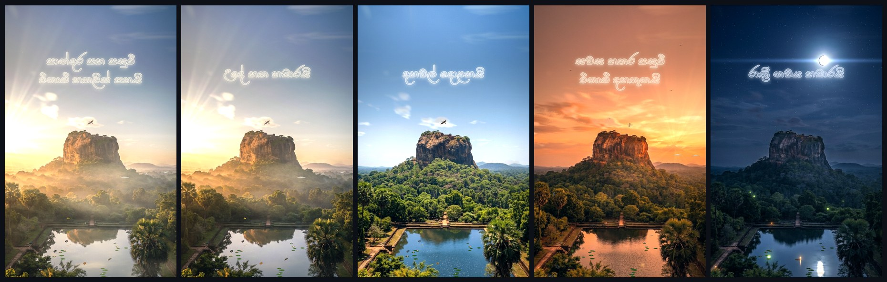
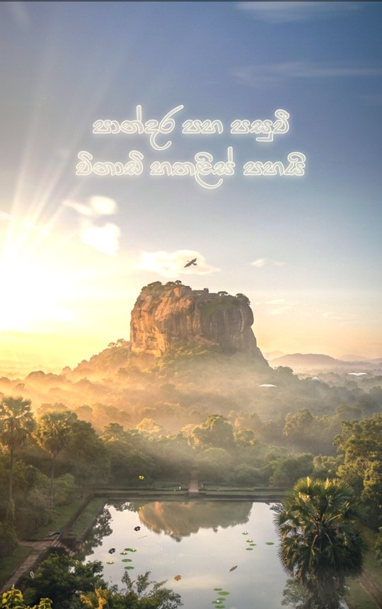
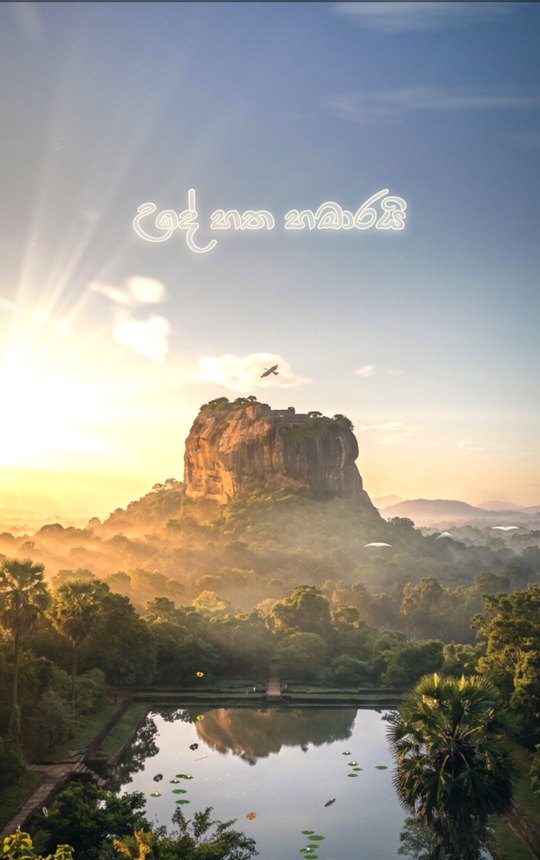
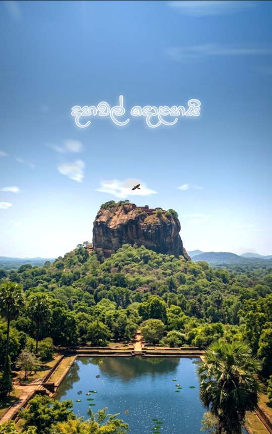
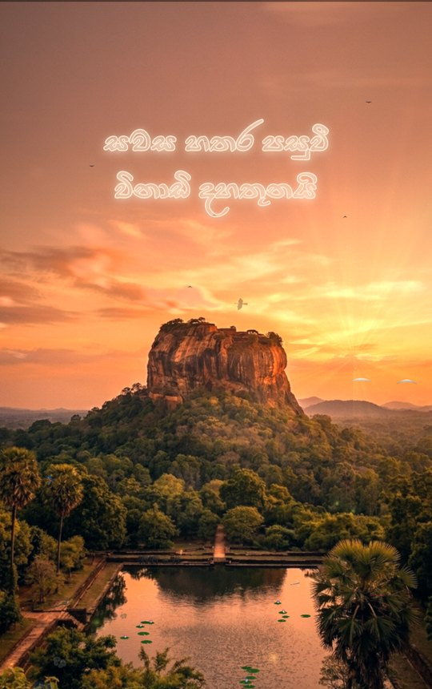
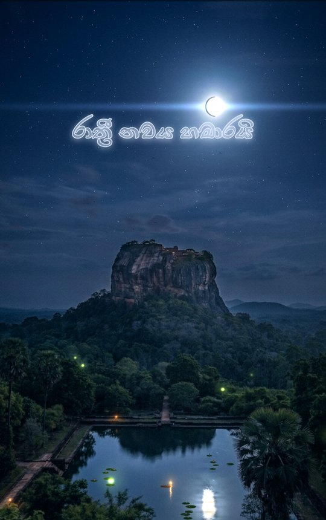
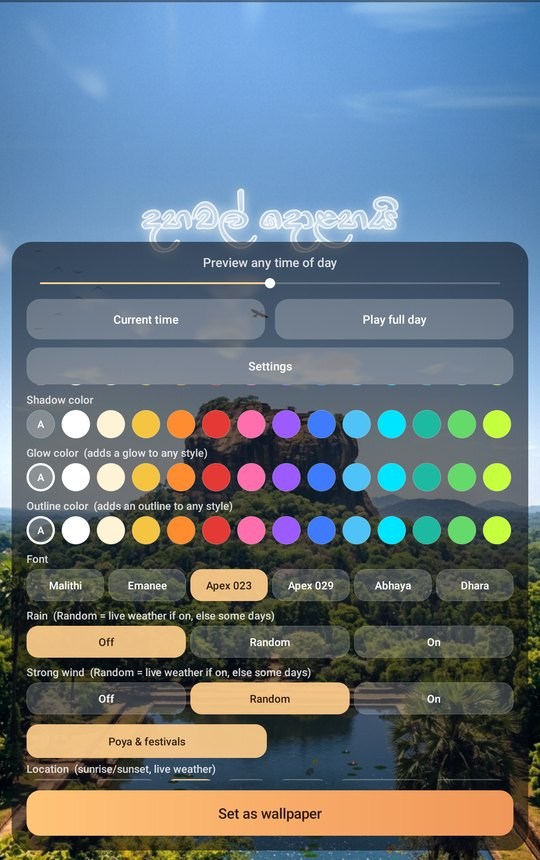
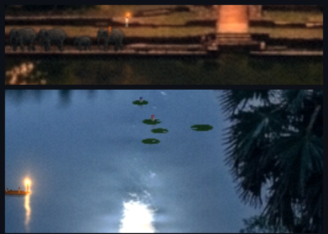
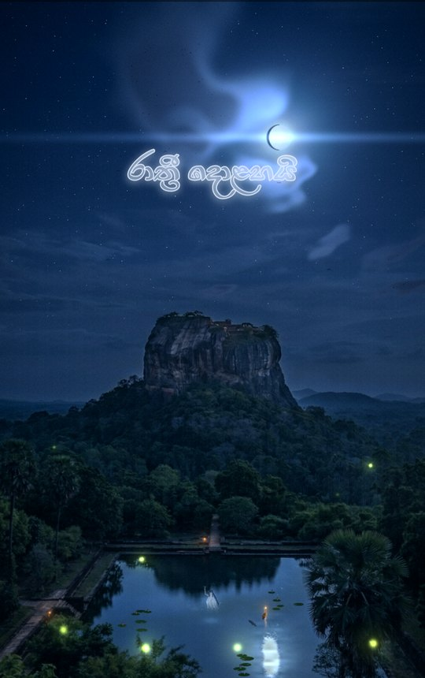
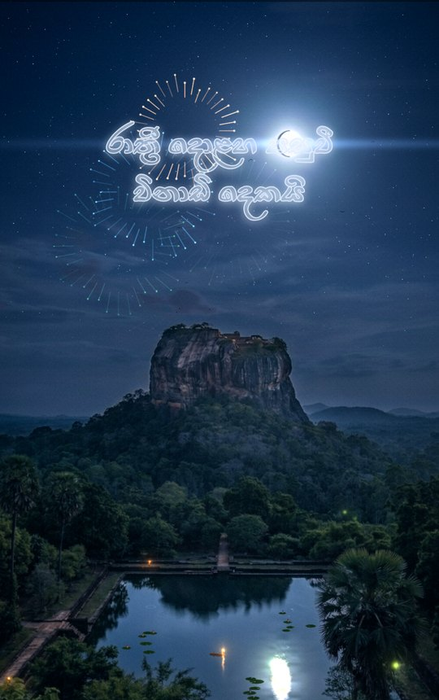

<div align="center">

# 🕰️ සිංහල වේලාව — Sinhala Welawa

### A living Sigiriya live wallpaper that tells the time in spoken Sinhala

*"රාත්‍රී නවය හමාරයි" — "දහවල් දොළහයි" — "සවස හතර පසුවී විනාඩි දහතුනයි"*


[](LICENSE)
[](https://claude.com/claude-code)



<br/>

[-2ea44f?style=for-the-badge&logo=android&logoColor=white)](https://github.com/00sanoj00/HelaClock-Wall/releases/latest)

</div>

---

## ✨ What is it?

**සිංහල වේලාව** is a free, ad-free Android live wallpaper. It shows the current time written the way
Sri Lankans actually *say* it, over a hand-tuned, fully animated scene of **Sigiriya** and its water garden.

The scene follows the real day. It uses actual sunrise and sunset times for your city, the real moon
phase and Poya days, and optionally the real weather.

> වෙලාව කතා කරන සිංහලෙන්, සීගිරියේ ජීවමාන දර්ශනයක් උඩ. දැන්වීම් නැහැ, tracking නැහැ, 100% නොමිලේ.

## 📸 Screenshots

| Dawn mist | Morning | Noon |
|:---:|:---:|:---:|
|  |  |  |
| **Evening** | **Night** | **Settings** |
|  |  |  |

<div align="center">
<br/>
<sub>Close-ups: an elephant herd drinking at dusk · a night boat lit by a torch</sub>
</div>

## 🌿 Features

**🕰️ Time in spoken Sinhala**
- Natural phrases such as "පාන්දර පහ පසුවී විනාඩි හතළිහයි" and "රාත්‍රී නවය හමාරයි".
- Rendered in **6 legacy FM / Isi Sinhala fonts**, using built-in Unicode → FM and Unicode → Isi converters.
- **10 text styles:** Shadow, Glow, Gold, Outline, Silver, Neon, Stone, Glass, Ember and 3D.
- Custom **text, shadow, glow and outline colours**, with presets and an HSV picker.
- Adjustable size and position. On the lock screen the text grows and moves down automatically.

**🌄 A living Sigiriya**
- Five AI-generated scenes (dawn, morning, noon, evening and night), made with Google Flow, blend smoothly through the day. They follow **real sunrise and sunset** for 13 Sri Lankan cities.
- **Sky:**
  - Rolling dawn mist in several drifting layers.
  - Drifting clouds and god rays.
  - Stars, shooting stars and the **real moon phase**.
- **Weather:**
  - Random midday rain, rainbows after the rain, and storms with lightning.
  - Strong wind bends the trees, ruffles the pond, raises dust and blows leaves.
- **Pond:**
  - Ripples, glinting water and moonlight reflections.
  - Lotus and water lilies that open in the day and close at night.
- **Wildlife:**
  - Butterflies, dragonflies and egrets.
  - A strutting peacock and leaping monkeys.
  - A diving kingfisher, jumping fish, parrot flocks and a soaring Brahminy kite.
  - Bats and fireflies.
- **People:**
  - Small groups walk around the pond towards the rock, carrying **torches at night**.
  - Boats row across the pond, and the night boat carries a burning torch.
- **🐘 Elephants:** a herd with a calf walks the pond's edge at **dawn and dusk** and stops to drink.
- **Festivals:** Poya lamps, Vesak lanterns and Avurudu erabadu petals appear on the right days. Poya days are calculated with the Meeus full-moon algorithm.
- **Live weather (optional):** uses Open-Meteo. Only the chosen city's coordinates are sent.

**⚡ Smooth and light**
- Frame rate options: **30 fps, 60 fps or Max**. Max uses up to **120Hz** on supported phones (`Surface.setFrameRate`).
- **Adaptive resolution** lowers the scene resolution automatically when frames run late. Text always stays sharp.
- Battery saver mode, and the wallpaper stops completely when the screen is off.

<details>
<summary><b>🤫 Easter eggs (spoilers!)</b></summary>

<br/>

| 👻 Exactly at midnight | 🎆 1 January |
|:---:|:---:|
|  |  |

- **12:00 midnight:** something white floats across the pond. It has no reflection.
- **Once a day,** at a random time, a 🛺 tuk-tuk drives around the pond.
- **Boat riders** sometimes meet a 🐊 crocodile and paddle away *very* fast.
- **1 April:** one of the elephants is… pink. 🐘💗
- **1 January:** fireworks over Sigiriya at midnight.

</details>

## 🛠️ Build

### Requirements

| Tool | Version |
|---|---|
| JDK | 17 |
| Android SDK | compileSdk / targetSdk **35**, minSdk **24** (Android 7.0) |
| Android Gradle Plugin | 8.10.0 |
| Kotlin | 2.2.0 |

The app has no third-party libraries. It uses only the Android framework, OpenGL ES 2.0 and `org.json`.

### Build and install

```bash
git clone https://github.com/00sanoj00/HelaClock-Wall.git
cd HelaClock-Wall
echo "sdk.dir=/path/to/Android/Sdk" > local.properties   # or open the project in Android Studio

./gradlew test             # unit tests (Sinhala time, converters, sun/moon calendar, weather logic)
./gradlew assembleDebug    # → app/build/outputs/apk/debug/app-debug.apk
adb install -r app/build/outputs/apk/debug/app-debug.apk
```

Open **සිංහල වේලාව** and tap **Set as wallpaper**.

### Release build (optional)

To sign release builds, create `release-keystore/keystore.properties` (this folder is git-ignored):

```properties
storeFile=../release-keystore/your-key.jks
storePassword=********
keyAlias=your-alias
keyPassword=********
```

Then run `./gradlew bundleRelease` or `./gradlew assembleRelease`. If that file is missing, release builds fall back to the debug key.

### Previewing any moment (developer extras)

The preview activity accepts intent extras, which makes testing easy:

```bash
adb shell am start -n lk.sinhala.welawa/.MainActivity --ei minute 1290 --ez hideui true   # 21:30
adb shell am start -n lk.sinhala.welawa/.MainActivity --ei minute 600 --ez poya true      # Poya day
# Also available: vesak, avurudu, thunder, rainbow, moon <0..1>, ghost, tuk, croc, aprilfool, newyear
```

## 🧭 How it works

```
base_image/1-5.jpg ─┐                        ┌─ SceneState    time of day, rain/storm/mist, live weather
font/*.ttf ─────────┼─► assets (synced)      ├─ SkyCalendar   sunrise/sunset, moon phase, Poya, festivals
mask.png (R sky,    │                        ├─ SinhalaTime   minute → spoken Sinhala phrase
 G water, B depth) ─┘                        ├─ TextPainter   FM/Isi text, 10 styles → texture
                                             └─ SceneRenderer GL: photo blend + depth parallax
                                                    │
                              assets/shaders/scene.frag  ◄── every effect (mist, rain, animals, boats,
                                                             people, elephants, easter eggs…) is
                                                             procedural GLSL drawn over the photo
```

- **One fragment shader** draws the whole living scene on top of the blended photos. The mask's depth channel drives parallax, occlusion behind trees and the size of each animal.
- **`WelawaWallpaperService`** paces frames with `Choreographer` to the display's vsync, and requests high refresh rates on Android 11+.
- Settings changes apply live. The renderer polls a `Settings.version` counter.

| File | Role |
|---|---|
| `SinhalaTime.kt` | Converts the time to a Sinhala phrase |
| `FmConverter.kt`, `IsiConverter.kt` | Convert Unicode Sinhala to legacy FM / Isi font encodings |
| `TextPainter.kt` | Text styles, colours and fonts, drawn to a bitmap texture |
| `SceneRenderer.kt` | The OpenGL renderer: adaptive resolution, uniforms and event timing |
| `SceneState.kt` | Time-of-day weights, weather, rain, storm and mist |
| `SkyCalendar.kt` | Sun times (NOAA), moon age, Poya (Meeus) and festivals |
| `LiveWeather.kt` | Optional Open-Meteo weather |
| `assets/shaders/scene.frag` | Every visual effect |

## 🔒 Privacy

- No ads, no analytics, no accounts.
- The only network request is the optional **Live weather** feature. It sends only the selected city's latitude and longitude to [Open-Meteo](https://open-meteo.com/).
- See [`store/privacy-policy.md`](store/privacy-policy.md).

## 🤝 Contributing

Contributions are welcome! Ideas, bug reports, new scenes (a beach scene is on the wishlist 🏖️) and
better Sinhala phrasing are all useful.

1. Fork the repo and create a branch: `git checkout -b my-idea`.
2. Run `./gradlew test` and try your change on a device or emulator.
3. Open a pull request with a screenshot or short video of the change.

## 👥 Credits

| | |
|---|---|
| 🧑‍💻 **Creator & developer: [00sanoj00](https://github.com/00sanoj00)** | Idea, design and art direction. Coding together with Claude Code. Sinhala phrasing, scene image creation, and testing on real devices |
| 🤖 **[Claude Code](https://claude.com/claude-code)** (Anthropic) | AI pair programmer: co-wrote the Kotlin and GLSL code, effects, converters, tests and this README |
| 🎨 **[Google Flow](https://labs.google/flow)** (Google Labs) | AI image generation for the five Sigiriya scenes (dawn, morning, noon, evening and night) |
| 🌦️ **[Open-Meteo](https://open-meteo.com/)** | Free weather API, used for the optional live weather |
| 🔤 **Fonts** | FM and Isi Sinhala fonts (`font/`) belong to their respective authors and are used for Sinhala rendering |

## 📄 License

The **source code** is licensed under the [GNU General Public License v3.0](LICENSE). You can use, study,
change and share it, but derived apps must stay open source under the same license.

The GPL does **not** cover these assets:
- The Sinhala fonts in `font/` belong to their respective authors.
- The Sigiriya scene images in `base_image/` were generated by the project creator with Google Flow. They and the store artwork in `store/` belong to the project creator.

Ask before reusing them outside this project.

<div align="center">

Made with ❤️ in Sri Lanka 🇱🇰 · සීගිරියේ සිට ආදරයෙන්

</div>
